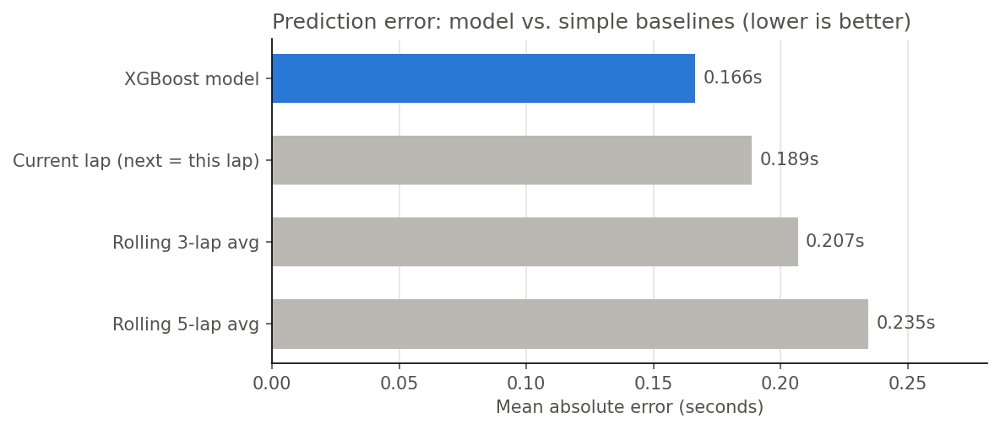
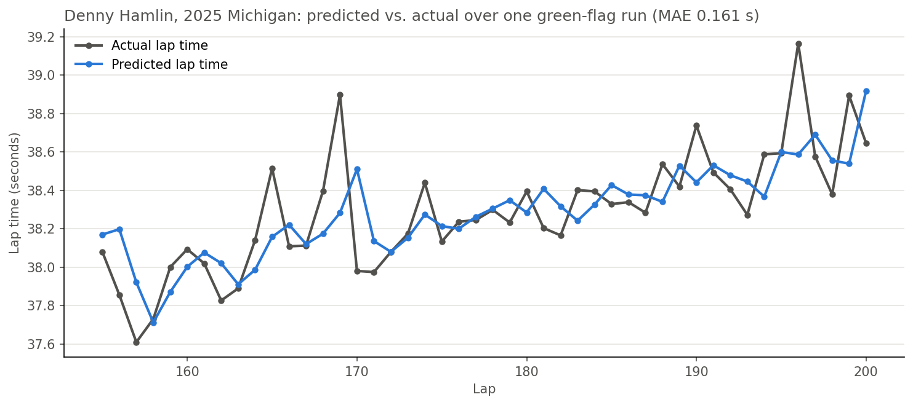
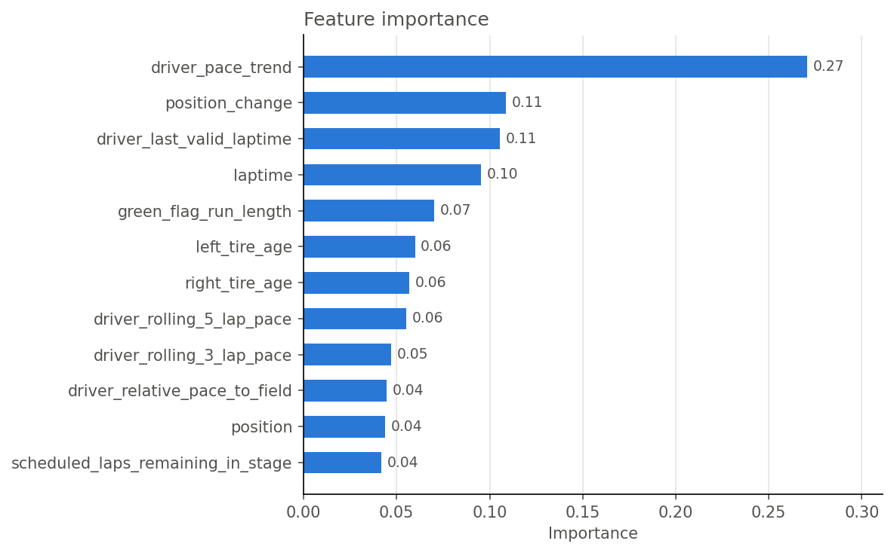
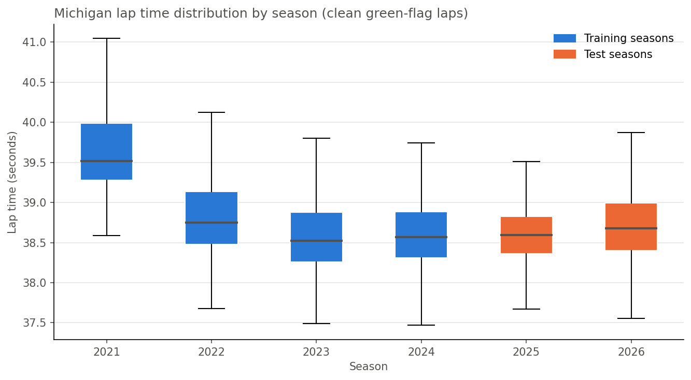

# NASCAR Next-Lap Pace Prediction (V1)

Predicting a NASCAR Cup Series driver's **next green-flag lap time** during a race, using only information available at that moment.

| | |
|---|---|
| **Track** | Michigan International Speedway (2.0-mile oval) |
| **Races** | 6 Cup Series races, 2021–2026 (FireKeepers Casino 400) |
| **Model** | XGBoost regression |
| **Target** | Change in lap time from the current lap to the next lap |
| **Test MAE** | **0.166 seconds** (~12% better than the best simple baseline) |
| **Data source** | [pynascar](https://pypi.org/project/pynascar/) |

---

## Table of Contents
1. [Overview](#overview)
2. [Results](#results)
3. [How It Works](#how-it-works)
4. [Design Decisions](#design-decisions)
5. [Error Analysis: The Pre-Caution Filter](#error-analysis-the-pre-caution-filter)
6. [Data Dictionary](#data-dictionary)
7. [Limitations](#limitations)
8. [Next Steps](#next-steps)
9. [Repository Structure](#repository-structure)
10. [How to Run](#how-to-run)

---

## Overview

During a green-flag run, a car's lap times change gradually as the tires wear, traffic shifts, and drivers manage the end of a stage. This project asks a narrow question: **given the current information, how fast will this driver's next lap be?**

The model is trained on four Michigan races (2021–2024) and tested on two races it never saw (2025–2026).
The test score reflects how well it predicts *future* races rather than laps from races it already learned from.

**What this project demonstrates**
- Turning raw lap-by-lap timing, pit stop, and caution data into race-specific features (tire age per side, green-flag runs, pace trend, pace relative to the field)
- Avoiding data leakage by building every feature from information available at the time of prediction
- Evaluating against honest baselines
- Using error analysis (checked against caution data and race footage) to decide what the model should and shouldn't be asked to predict

---

## Results

### Model vs. baselines

Each baseline makes a "prediction" without a model and is graded the same way: mean absolute error (MAE) against the actual next lap time.

| Method | Test MAE (s) | Model improvement |
|---|---|---|
| **XGBoost model** | **0.166** | — |
| Current lap (next lap = this lap) | 0.189 | 11.8% |
| Rolling 3-lap average | 0.207 | 19.5% |
| Rolling 5-lap average | 0.235 | 29.0% |



The simplest rule, "the next lap will match the lap just completed," is a strong baseline because lap times change gradually during a run. Rolling averages perform worse because they lag behind tire falloff; they still include older and/or faster laps. The model beats the best baseline by about 12%, mainly by anticipating how quickly each driver's tires are falling off.

On average, the model's prediction is about 0.166 seconds off in either direction, which is roughly 0.4% of a ~38.5 s Michigan lap. Next-lap pace is hard to predict given the many factors involved: track conditions and the race situation each driver is in.

There is still room for improvement, since the model was only trained on 4 races at one track.

> **Note:** MAE is measured on clean green-flag laps. Laps within 5 laps before a caution are excluded (see [Error Analysis](#error-analysis-the-pre-caution-filter)).

### How close are the predictions?

| Within | Share of test laps |
|---|---|
| 0.10 s | 41.6% |
| 0.25 s | 78.8% |
| 0.50 s | 96.0% |

**Train MAE: 0.163 s · Test MAE: 0.166 s.** The two are close, so the model is not overfitting to the training race data.

### What the predictions look like

One driver's longest green-flag run from a test race the model never saw:



We can see from the chart that while the model may be off by a little more than a tenth of a second, it is still able to follow the trend of tire wear through a run during a race.

### Feature importance



`driver_pace_trend` is by far the most important feature (~27%). How quickly a driver's lap times are rising (or how fast the tires are falling off) tells the model the most about the next lap. Because the model predicts the *change* in lap time, it leans on signals of tire wear and race situation rather than each car's overall speed.

---

## How It Works

### Pipeline

```
Raw data (pynascar)            Feature engineering                 Model
───────────────────            ───────────────────                 ─────
lap times / speeds   ─┐
pit stops (type)      ├──►  build_race_dataset()  ──►  one row per  ──►  XGBoost  ──►  predicted change
cautions              │     (per race)                 driver per lap                 + current lap
race metadata        ─┘                                                               = predicted next lap
```

`build_race_dataset()` runs once per race and:
1. Converts lap speed to lap time and flags **valid laps** (removes pit, caution, and incident laps)
2. Tracks **tire age** separately for right- and left-side tires
3. Splits each driver's race into **runs** that reset at every tire change or restart
4. Builds **pace features** within each run: recent lap times, rolling averages, pace trend, and pace relative to the field
5. Creates the **target** (next lap's change in pace) and keeps only clean green-flag laps

### Predicting the change, not the lap time

The model predicts how much the next lap will differ from the current one. The predicted lap time is then rebuilt:

```python
predicted_change = model.predict(X_test)                         # e.g. +0.04 s
predictions      = test_df['laptime'].values + predicted_change  # predicted next lap time
```

### Tire age by side

A 4-tire stop resets both sides, a 2-tire stop resets only that side, and fuel-only stops reset nothing. Tire age only counts **green-flag** laps, since caution laps add little wear.

```python
right_stops = race_pits[race_pits['pit_stop_type'].isin(['FOUR_WHEEL_CHANGE', 'TWO_WHEEL_CHANGE_RIGHT'])]
left_stops  = race_pits[race_pits['pit_stop_type'].isin(['FOUR_WHEEL_CHANGE', 'TWO_WHEEL_CHANGE_LEFT'])]

# Green-flag laps since that side was last changed
race_speed['right_tire_age'] = (
    race_speed.groupby(['driver_name', 'last_right_tire_change'])['green_lap'].cumsum())
```

### Pace trend (the top feature)

The slope of a straight line fit through a driver's last 3–5 valid laps in the current run. Positive means lap times are rising (tire falloff); negative means the driver is speeding up.

```python
valid_laps['driver_pace_trend'] = (
    valid_laps.groupby(['driver_name', 'run_id'])['laptime']
    .rolling(window=5, min_periods=3)
    .apply(lambda laptimes: np.polyfit(np.arange(len(laptimes)), laptimes, 1)[0], raw=True)
    .reset_index(level=[0, 1], drop=True))
```

### Train / test split by season

```python
train_races = {
    2021: 5031,
    2022: 5170,
    2023: 5296,
    2024: 5415}

test_races  = {
    2025: 5573,
    2026: 5612}
```

| Set | Seasons | Laps |
|---|---|---|
| Training | 2021–2024 | 14,983 |
| Test | 2025–2026 | 6,885 |

### Model

```python
model = XGBRegressor(
    n_estimators=300,     # number of trees, each correcting the previous ones' errors
    learning_rate=0.05,   # small steps = steadier learning
    max_depth=4,          # shallow trees = simpler patterns, less overfitting
    random_state=42)
```

A conservative, untuned starting configuration chosen to limit overfitting with only four training races.

---

## Design Decisions

**Predict the change, not the raw lap time.** The target, `next_lap_change`, focuses on *what drives pace changes* (tire falloff, end-of-stage behavior, traffic) instead of memorizing how fast each car is.

**Split by season, not randomly.** A random split would put laps from the same race in both training and test sets, which inflates accuracy. Training on 2021–2024 and testing on 2025–2026 mirrors how the model would actually be used.

**Keep the 2021 (Gen-6) race.** 2021 was the last year of the previous-generation car and was clearly slower at Michigan (see chart below). It stayed in because removing it made test accuracy worse: the model learns patterns like tire falloff that carry over between car generations.



From 2022 on, the field's pace is stable (medians around 38.5–38.7 s), and the test seasons fall in the same range as training.

**Track tire age separately for each side.** Two-tire stops are common, so a single "tire age" would be wrong for half the car.

**Runs reset at tire changes and restarts; tire age does not reset at restarts.** Pace features (rolling averages, trend) restart with each run so old-tire laps never mix with new-tire laps. But if a driver stays out under caution, their tires are still old, so tire age keeps counting.

**Use scheduled stage lengths, not actual stage ends.** Scheduled lengths are known before the race, so `scheduled_laps_remaining_in_stage` uses no future information.

```python
stage_1_end = stage_1_scheduled_laps
stage_2_end = stage_1_scheduled_laps + stage_2_scheduled_laps
stage_3_end = stage_1_scheduled_laps + stage_2_scheduled_laps + stage_3_scheduled_laps

# np.select() checks the conditions in order and uses the first one that's True
race_speed['scheduled_laps_remaining_in_stage'] = np.select(
    [race_speed['Lap'] <= stage_1_end,          # in Stage 1
     race_speed['Lap'] <= stage_2_end],         # in Stage 2
    [stage_1_end - race_speed['Lap'],
     stage_2_end - race_speed['Lap']],
    default=stage_3_end - race_speed['Lap']     # otherwise: Stage 3
).clip(min=0)                                   # 0 during overtime laps
```

**Let XGBoost handle missing values.** Early in a run, features like the rolling 5-lap pace don't exist yet. Those rows are kept as `NaN` rather than dropped, because XGBoost handles missing values natively.

**Features tested and removed.** `Lap`, `laps_remaining`, and `current_pos_group` were dropped because they did not improve test accuracy.

---

## Error Analysis: The Pre-Caution Filter

In an earlier version, the largest misses (2–3 seconds) were clustered on the **same laps across many cars**. Matching those laps against the official caution data, and reviewing race footage, showed two causes:

1. **An incident unfolding just before the caution was officially called.** At times, the `start_lap` NASCAR records for a caution comes after the incident has already happened and drivers have already slowed down.
   *Example (2025 Michigan):* the API recorded the "Car #34 Incident Turn 2" caution as starting on lap 147. The TV broadcast shows the leaders completing lap 145 at full speed, then the incident happening during lap 146. Lap 146 was about 2.5 s slower for the leaders (Busch, Reddick, Hamlin, Hocevar), but it was still marked as a green-flag lap in the data.

2. **The final lap of a stage**, where cars not in danger of losing track position back off (presumably to save time refueling in the pits).
   *Example (2026 Michigan):* Stage 1 was scheduled to end on lap 45, but the stage caution was recorded as starting on lap 47. Seven cars running P21–P29 slowed down on lap 45.

Neither can be predicted from lap data alone, and the recorded caution lap can lag the real event by a lap or two. So laps within 5 laps before a caution were removed from V1's scope:

```python
for _, caution in race_cautions.iterrows():
    if caution['flag_state'] != 1:
        start = caution['start_lap']
        race_speed.loc[race_speed['Lap'].between(start - 5, start - 1), 'pre_caution'] = True
```

**Effect:** test MAE dropped from about **0.176 s to 0.166 s**. Most of that gain came from removing unpredictable laps, not from the model improving. The model's edge over the best baseline stayed about the same (~12%).

**Remaining large misses** include cars running well off their normal pace (damage, battling for position, working through traffic), which a lap-time-only model has no way to anticipate.

---

## Data Dictionary

<details>
<summary><b>Model features (12)</b></summary>

| Feature | Description |
|---|---|
| `laptime` | Lap most recently completed (seconds), converted from lap speed and track length |
| `driver_last_valid_laptime` | The previous valid lap in the current run |
| `driver_rolling_3_lap_pace` | Average of the last 3 valid laps in the current run |
| `driver_rolling_5_lap_pace` | Average of the last 5 valid laps in the current run (blank until 3 laps into the run) |
| `driver_pace_trend` | Slope of the last 3–5 valid laps. (+) = slowing / tire falloff, (−) = speeding up |
| `driver_relative_pace_to_field` | Rolling-5 pace minus the field's median rolling-5 pace on that lap. (−) = faster than the field |
| `right_tire_age` | Green-flag laps since the right-side tires were changed |
| `left_tire_age` | Green-flag laps since the left-side tires were changed |
| `position` | Current running position |
| `position_change` | Positions gained (+) or lost (−) since the previous lap |
| `scheduled_laps_remaining_in_stage` | Laps left in the current stage, based on scheduled stage lengths |
| `green_flag_run_length` | Consecutive green-flag laps since the last restart (same for the whole field) |

</details>

<details>
<summary><b>Target</b></summary>

| Column | Description |
|---|---|
| `next_lap_change` | Next lap time minus current lap time. (+) = slower, (−) = faster |
| `driver_next_laptime` | The actual next lap time (used to grade predictions) |

</details>

<details>
<summary><b>Raw data files (<code>data/</code>)</b></summary>

| File | Contents |
|---|---|
| `michigan_lap_times.csv` | Lap-by-lap speeds and running positions for every driver, all six races |
| `michigan_pit_stops.csv` | Pit stops with lap and stop type (`FOUR_WHEEL_CHANGE`, `TWO_WHEEL_CHANGE_RIGHT`, `TWO_WHEEL_CHANGE_LEFT`, `OTHER`) |
| `michigan_cautions.csv` | Caution periods: start lap, end lap, flag state, reason |
| `michigan_race_metadata.csv` | Season, race ID, race name, date, scheduled laps, stage lengths |
| `cup_tracks.csv` | Track lengths, used to convert lap speed (mph) to lap time (s) |

All files except `cup_tracks.csv` were pulled with pynascar in `fetch_data.ipynb`. Each file holds every Michigan Cup Series race from 2021–2026; `race_id` identifies the race.

</details>

<details>
<summary><b>Filters (which laps the model trains and tests on)</b></summary>

| Filter | Rule | Why |
|---|---|---|
| Valid current lap | Within ±2.5 s of the driver's race median | Removes pit-in/out, caution, and incident laps |
| Valid next lap | Same rule applied to the next lap | The target must be a clean lap |
| Not pre-caution | Next lap is not within 5 laps before a caution | Incidents and stage-end lifts can't be predicted from lap data |
| Settled run | `green_flag_run_length` ≥ 3 | Skips the chaotic first laps after a restart |

</details>

---

## Limitations

- **Model trained on a single track.** All six races are at Michigan. Tire wear and falloff rates differ between tracks, so the model has not yet been able to learn the racing characteristics of other intermediate ovals.
- **Accuracy is measured on laps that stayed green.** The pre-caution filter uses known caution times, so it can only be applied to historical data. In a live race, the model assumes the run stays green until a caution is called; the 0.166 s MAE does not cover laps leading into a caution.
- **Small dataset.** Four training races and two test races. Results could shift with more races.
- **Valid-lap cleaning uses the whole race.** Each driver's median lap time (used to flag valid laps) is computed over the full race. This is a data-cleaning step, not a model feature, but a live version would need a running median instead.
- **No information beyond lap timing.** The model can't see damage, traffic, aero position, weather, or fuel strategy, which explains many of the remaining large misses.
- **Untuned hyperparameters.** The XGBoost settings are a conservative starting point. Tuning should use a separate validation season, not the test set.

---

## Next Steps

- **V2 pace model:** predict each driver's pace over the next 5 laps relative to the field
- **Pit strategy simulation:** a Monte Carlo pit-vs.-stay-out simulation built on the pace model
- **Dashboard:** a Streamlit app with Pace Outlook, Pit Decision, and Backtest pages
- Expand beyond Michigan to other track types (short track, mile, intermediate, road course, superspeedway) and tune hyperparameters on a held-out validation season

---

## Repository Structure

```
├── nascar_next_lap_prediction_v1.ipynb   # Main notebook: features, model, evaluation, charts
├── fetch_data.ipynb                      # Pulls raw race data with pynascar
├── requirements.txt
├── data/
│   ├── michigan_lap_times.csv
│   ├── michigan_pit_stops.csv
│   ├── michigan_cautions.csv
│   ├── michigan_race_metadata.csv
│   └── cup_tracks.csv
└── images/                               # Charts used in this README
```

---

## How to Run

```bash
git clone https://github.com/hermanmckinney3/nascar-laptime-prediction-model-v1.git
cd nascar-laptime-prediction-model-v1
pip install -r requirements.txt
jupyter notebook nascar_next_lap_prediction_v1.ipynb
```

The `data/` folder is included so the main notebook runs without re-pulling data. To refresh the data: run `fetch_data.ipynb` first.

---

**Herman McKinney**<br>
M.S. Informatics & Analytics, University of North Carolina at Greensboro<br>
[LinkedIn](https://www.linkedin.com/in/herman-mckinney-090b93214) · [hermanmckinney3@gmail.com](mailto:hermanmckinney3@gmail.com)
